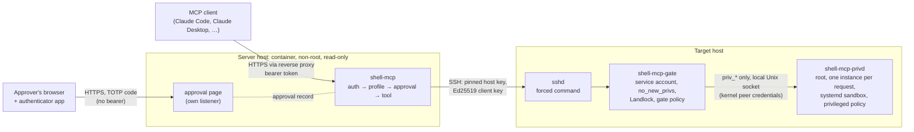

# shell-mcp

[](https://github.com/tyler-rich/shell-mcp/actions/workflows/ci.yml)
[](https://github.com/tyler-rich/shell-mcp/releases/latest)
[](LICENSE)

shell-mcp is a [Model Context Protocol](https://modelcontextprotocol.io) server that gives AI clients (Claude Code, Claude Desktop, MCP Inspector, any client that can send a bearer header) bounded, audited access to Linux hosts over SSH. It reads and changes what container managers cannot reach: systemd services and the journal, host and root-owned configuration files, ownership and permissions, packages, disks, processes, TLS certificates and git checkouts. It is **not a remote shell**: there is no shell, no PTY, no interpreter and no free-form command line, and every operation runs on the host under a root-owned policy that the server cannot change.

**Status: 0.1.0, the first release.** Before 1.0, tool names, arguments and configuration can change in a minor release; read [`CHANGELOG.md`](CHANGELOG.md) before upgrading, and pin the image by digest.

## Contents

- [What it does and why](#what-it-does-and-why)
- [Features](#features)
- [Architecture](#architecture)
- [Security model](#security-model)
- [Requirements](#requirements)
- [Quick start](#quick-start)
- [Installation](#installation)
- [Configuration reference](#configuration-reference)
- [Connecting clients](#connecting-clients)
- [Verifying a release](#verifying-a-release)
- [Upgrading](#upgrading)
- [Troubleshooting](#troubleshooting)
- [Documentation](#documentation)
- [Development](#development)
- [Reporting a vulnerability](#reporting-a-vulnerability)
- [License](#license)

## What it does and why

An AI agent that can run commands on a server is useful, and dangerous if a prompt it reads can make it run anything. The usual "SSH MCP server" gives the model a shell over SSH; a shell cannot be made safe, because every program it can start brings its own ways out. shell-mcp starts from what a misled or compromised model must *not* be able to do, and builds the access around that.

- **The host decides, not the server.** The MCP server only decides which tools a client sees (its *profile*). What actually runs on a host is decided there, by `shell-mcp-gate`, which sshd starts as the server's SSH key's forced command. The gate reads a root-owned policy that names the directories it may read and write, the units it may watch or restart, the repositories it may pull, and the commands it may run, each as exact argument templates. A stolen bearer token, a prompt-injected model or a compromised server container can do at most what that policy allows for that key.
- **Root through a separate helper, never sudo.** When root is the job (a root-owned config file, `chown`, a package), the gate stays unprivileged and *asks* `shell-mcp-privd`, a socket-activated helper that systemd starts once per request. The helper checks the caller by kernel peer credentials, applies its own root-owned policy, runs in a systemd sandbox generated from that policy, and backs up what it changes. There is no sudoers file and no setuid binary.
- **The kernel enforces it too.** Before the gate reads a request it sets `no_new_privs` and applies a Landlock sandbox computed from the policy, inherited by everything it starts. A bug in the gate's own path checks still hits a kernel wall.
- **A person approves what matters.** Deletes, git discards and every root-level change need a human's approval on the server's own web page, with a code from the approver's authenticator app, bound to the exact operation and its preview. The model cannot approve its own request.

What makes it different from a shell over SSH: no command line is ever interpreted; a declared program gets only the argument shapes the host owner wrote; programs that run other programs (shells, interpreters, `env`, `xargs`, `sudo`, …) are refused under any name; and every change is previewed, verified by reading it back, and logged on the host where the server cannot erase it.

## Features

- **Read tools** (every profile): system info, disks, processes, services and the journal, directories, files, `find`, certificates, git status, log and diff, read-tier policy commands, and previews of deletes and git discards. Output is redacted (private keys, tokens, configured patterns) and size-capped.
- **Operator tools** (`operator` and `admin`): start, stop, restart and reload of declared units (through a generated polkit rule), atomic file writes verified by reading them back, mkdir, copy, move, chmod, fast-forward `git pull` from a pinned remote, and operator-tier policy commands.
- **Destructive tools** (`admin`): delete and git discard, each removing exactly what its approved preview listed or nothing, and destructive-tier commands.
- **Privileged tools** (`admin`, with the helper installed): root reads, writes, chown, chmod, copy, move and delete with backups and restore, root commands, apt package operations bound to an approved transaction of exact versions, and a delayed, cancellable reboot or power-off through logind.
- **Approvals**: out of band on the server's approval page, with TOTP codes from an enrolled approver, single-use and bound to principal, tool, target, arguments, preview and both policies. Off by default (gated tools refuse until approvals are set up).
- **Audit**: the server logs one JSON line per tool call; the gate logs one line per request to the host's syslog and the helper one per connection to the journal, joined by the request id. Contents, output, tokens and keys are never logged.

### Tools

50 tools, generated from the server's catalogue (`shell-mcp tools`). A profile registers its own tier and every tier below it; tools above it do not exist for the client. *Approval* is what a call needs under `SHELL_MCP_APPROVAL_METHOD=web`; with the default `none`, every tool that would need approval refuses.

#### Read tools: every profile (19)

| Tool | Approval | What it does |
|---|---|---|
| `shell_find_files` | never | Searches a directory tree with bounded depth and results, by name glob, type and modification age. |
| `shell_get_disk_usage` | never | Returns each mounted filesystem's type, size, used and available bytes and inode counts. |
| `shell_get_git_diff` | never | Returns a repository's uncommitted or staged changes as a unified diff, redacted and size-capped. |
| `shell_get_git_log` | never | Returns a repository's most recent commits: hash, author name, date and subject. |
| `shell_get_git_status` | never | Returns a repository's branch, HEAD, upstream, ahead/behind counts and changed or untracked paths. Superproject only: submodule work trees are never inspected (not their changes or checked-out commit); staged gitlink changes are seen. |
| `shell_get_journal` | never | Returns the most recent journal lines of one systemd unit, optionally by time range and priority, redacted and size-capped. |
| `shell_get_policy` | never | Returns a target gate's version, principal, sandbox status and effective policy: roots, limits, services, repositories, commands with their templates, and privileged forwarding with the privileged helper's policy summary. |
| `shell_get_service_status` | never | Returns a systemd unit's load, active and sub state, main PID, timestamps, memory, restart count and unit file state. |
| `shell_get_system_info` | never | Returns the target's OS release, kernel, hostname, uptime, load averages, memory and CPU count. |
| `shell_inspect_certificate` | never | Parses every certificate in a PEM or DER file and returns subject, issuer, names, validity, days remaining, key and fingerprint; files holding a private key are refused. |
| `shell_list_directory` | never | Lists a directory's entries with type, size, mode, owner, group and modification time; symlink targets are reported, not followed. |
| `shell_list_processes` | never | Lists the target's processes with user, state, memory, CPU time, start time and a redacted command line, filtered and sorted. |
| `shell_list_services` | never | Lists the target's loaded service units that its policy allows, with load, active and sub state. |
| `shell_list_targets` | never | Lists the configured SSH targets with their name, host, port and user, without contacting them. |
| `shell_preview_delete` | never | Reports what deleting a path would remove, without removing anything: type, entry count, total bytes, the first 50 entries and a hash of the complete list. |
| `shell_preview_git_discard` | never | Reports what discarding a repository's uncommitted changes would restore and remove, without changing anything: counts, the first 50 paths and a hash of the complete list. |
| `shell_read_file` | never | Reads a bounded part of a text file, or its last lines, redacted; a binary file returns only its size and SHA-256. |
| `shell_run_read_command` | never | Runs a read-tier command declared in the target policy with arguments matching one of its templates, and returns its exit status and redacted, size-capped output. |
| `shell_stat_path` | never | Returns one path's type, size, mode, owner, group and modification time without following a final symlink, whose target is reported. |

#### Operator tools: `operator` and `admin` (8)

| Tool | Approval | What it does |
|---|---|---|
| `shell_control_service` | only with `operator` in `SHELL_MCP_APPROVAL_TIERS` | Starts, stops, restarts or reloads a systemd unit the target policy allows, and returns the unit's status re-read after the action. |
| `shell_copy_path` | only with `operator` in `SHELL_MCP_APPROVAL_TIERS` | Copies a regular file to a destination under the target policy's write roots, verified by reading the copy back. |
| `shell_git_pull` | only with `operator` in `SHELL_MCP_APPROVAL_TIERS` | Fast-forwards a repository listed in the target policy from its pinned remote, refusing uncommitted changes to tracked files and diverged history, and returns the old and new HEAD. |
| `shell_make_directory` | only with `operator` in `SHELL_MCP_APPROVAL_TIERS` | Creates a directory, and optionally its missing parents, under the target policy's write roots. |
| `shell_move_path` | only with `operator` in `SHELL_MCP_APPROVAL_TIERS` | Renames a file or directory within one write root of the target policy (same filesystem only). |
| `shell_run_command` | by the command's tier | Runs a read- or operator-tier command declared in the target policy with arguments matching one of its templates and optional standard input, and returns its exit status and redacted, size-capped output. |
| `shell_set_permissions` | only with `operator` in `SHELL_MCP_APPROVAL_TIERS` | Sets the permission bits of a file or directory under the target policy's write roots, and returns the old and new mode. |
| `shell_write_file` | only with `operator` in `SHELL_MCP_APPROVAL_TIERS` | Atomically replaces or creates a text file under the target policy's write roots and verifies it by reading it back, returning the old and new SHA-256 and line counts. Content passes through the client and its model provider, so generate private keys on the host instead. |

#### Destructive tools: `admin` only (3)

| Tool | Approval | What it does |
|---|---|---|
| `shell_delete_path` | always | Deletes a file, an empty directory, or with recursive a directory tree under the target policy's write roots, exactly as its approved preview listed it. |
| `shell_discard_git_changes` | always | Restores a repository's tracked files and index to HEAD and, with include_untracked, removes untracked files, exactly as its approved preview listed them. Superproject only: submodule work trees are never inspected (not their changes or checked-out commit); staged gitlink changes are seen. |
| `shell_run_command` | by the command's tier | Runs a read-, operator- or destructive-tier command declared in the target policy with arguments matching one of its templates and optional standard input, exactly as its approved preview resolved it, and returns its exit status and redacted, size-capped output. |

#### Privileged tools (as root, through the helper): `admin` only (21)

| Tool | Tier | Approval | What it does |
|---|---|---|---|
| `shell_priv_cancel_power` | read | never | Cancels, as root, the reboot or power-off the host's privileged helper scheduled and has not yet requested; returns the cancelled action and its time. |
| `shell_priv_list_backups` | read | never | Lists, as root, the backups the privileged helper kept of what it overwrote or deleted, newest first: id, kind, original path, owner, mode, size, SHA-256, time and operation. |
| `shell_priv_list_directory` | read | never | Lists, as root, a directory's entries under the privileged policy's roots with type, size, mode, owner, group and modification time; symlink targets are reported, not followed. |
| `shell_priv_preview_delete` | read | never | Reports, as root, what deleting a path within the host's privileged write roots would remove and back up, without changing anything: type, entry count, total bytes, the first 50 entries, the backup and a hash of the complete list. |
| `shell_priv_preview_packages` | read | never | Reports, as root, what installing, upgrading or removing packages would change, without changing anything: every package with its exact version, and a hash of the transaction. |
| `shell_priv_read_file` | read | never | Reads, as root, a bounded part of a text file under the privileged policy's roots, or its last lines, redacted; a binary file returns only its size and SHA-256. |
| `shell_priv_stat_path` | read | never | Returns, as root, one path's type, size, mode, owner, group and modification time under the privileged policy's roots, without following a final symlink, whose target is reported. |
| `shell_priv_change_owner` | operator | always | Changes the owner and/or group of a file or directory as root (with recursive, also of everything under it) within the host's privileged write roots, exactly as its approved preview listed; returns the counts and the owner set. |
| `shell_priv_copy_path` | operator | always | Copies a regular file as root to a destination within the host's privileged write roots, backing up a replaced destination and verifying by read-back; returns the hashes, mode, owner and backup ids. |
| `shell_priv_install_packages` | operator | always | Installs, as root, allow-listed packages exactly as their approved preview resolved them, every package at its approved version, never removing any; returns what dpkg shows was installed. |
| `shell_priv_make_directory` | operator | always | Creates a directory as root, and optionally its missing parents, within the host's privileged write roots; returns its mode and owner. |
| `shell_priv_move_path` | operator | always | Renames a file or directory as root within one of the host's privileged write roots (same filesystem only), backing up a replaced destination file; returns what was moved and the backup ids. |
| `shell_priv_restore_backup` | operator | always | Restores, as root, a backup the privileged helper kept, over exactly the version its approved preview showed (that version is backed up first), with the recorded owner and the recorded mode within the host's mask; returns the modes set and the new backup's id. |
| `shell_priv_set_permissions` | operator | always | Sets the mode of a file or directory as root (with recursive, also of everything under it) within the host's privileged write roots, exactly as its approved preview listed; returns the counts and the old and new mode. |
| `shell_priv_update_package_index` | operator | always | Updates, as root, the host's package index from its configured sources; returns apt-get's exit status and redacted, size-capped output. |
| `shell_priv_upgrade_packages` | operator | always | Upgrades, as root, exactly the packages its approved preview listed, each to its approved version, never installing what was not approved nor removing anything; returns what dpkg shows was upgraded. |
| `shell_priv_write_file` | operator | always | Atomically writes a text file as root within the host's privileged write roots, backing up what it replaces and verifying by read-back; returns the hashes, line counts, mode, owner and backup ids. Content passes through the client and its model provider, so generate private keys on the host instead. |
| `shell_priv_delete_path` | destructive | always | Deletes, as root, a file, an empty directory, or with recursive a directory tree within the host's privileged write roots, exactly as its approved preview listed it, after backing it up; returns the counts and the backup ids. |
| `shell_priv_reboot_host` | destructive | always | Reboots or powers off the host as root: answers at once with the time the action will be requested from logind, 60 seconds later, unless it is cancelled, or blocked by a package operation or an inhibitor lock, first. |
| `shell_priv_remove_packages` | destructive | always | Removes, as root, allow-listed packages exactly as their approved preview listed them, keeping their configuration files; returns what dpkg shows was removed. |
| `shell_priv_run_command` | destructive | always | Runs, as root, a command declared in the host's privileged policy with arguments matching one of its templates, exactly as its preview resolved it and in the unit it named, and returns its exit status and redacted, size-capped output. |

`shell_run_command` is registered twice: at operator tier in the `operator` profile (read and operator commands) and at destructive tier in `admin` (all three). The full contract, with every input and result: [`docs/TOOLS.md`](docs/TOOLS.md).

## Architecture



| Component | Runs where, as whom | What it does |
|---|---|---|
| `shell-mcp` (server) | A distroless container, uid 65532, read-only, no capabilities, no Docker socket | Authenticates the client (bearer token), registers the tools of its profile, holds approval records, calls the gate over SSH, and shapes each answer into one JSON envelope. It holds no host access of its own. |
| Approval page | The same process, on its own listener (default `127.0.0.1:8081`) | Shows a pending operation's server-written description and preview, and records an approver's decision with a TOTP code. Never accepts the bearer token. |
| `shell-mcp-gate` | Each target, as a dedicated unprivileged service account, started by sshd per request | Checks its own install, applies `no_new_privs` and Landlock, then reads one request and checks it against the gate policy: tier, paths, units, repositories, command templates, sizes. Runs native operations or `execve`s declared binaries; forwards `priv_*` requests to the helper. |
| `shell-mcp-privd` | Each target that needs root, as root, one systemd instance per connection | Authenticates the gate's account by `SO_PEERCRED`, checks its own policy and that its units match it, then does the one operation in its generated sandbox (the *core* unit; or the root-equivalent *broad* unit, for packages, power and declared broad commands). |

**Trust boundaries.** The client and the model are untrusted, even after authentication (anything they read can carry instructions). The gate treats the server as hostile: the server's profile only limits what is advertised, and the gate re-validates everything. The helper treats the gate as hostile in turn. The host policies, binaries and units are root-owned and out of the service account's reach, so nothing above them can widen them. Detail: [`docs/ARCHITECTURE.md`](docs/ARCHITECTURE.md), [`docs/SECURITY.md`](docs/SECURITY.md).

## Security model

The layers, from the network to the kernel:

1. **Authentication before anything.** Every MCP request needs the bearer token (at least 43 characters), `tools/list` included; Host and Origin allow-lists stop DNS rebinding; per-client rate limits and an auth-failure lockout stop guessing.
2. **Profiles.** `read-only` (default), `operator` or `admin`, fixed at start. Tools above the profile are never registered.
3. **Pinned SSH.** Host keys are pinned per target (never trust on first use); the client key is Ed25519; no agent, forwarding or PTY.
4. **The forced command.** Each SSH key's `authorized_keys` line is `restrict`, `from=` and `command="shell-mcp-gate serve --policy …"`, so a key can only ever reach the gate, with the policy its line names. The keys file is root-owned, so the service account cannot edit it.
5. **The gate policy.** Exact read and write roots; a built-in deny list (private keys, shadow files, `/root`, …) and protected set (`/etc/ssh`, `/etc/systemd`, `/usr`, cron, the policy directory, `.git`, …) that no policy can remove; exact unit and verb lists; pinned repositories with their remotes; and commands as argv templates with typed placeholders, whose values may never start with `-`. `max_tier` caps every key.
6. **Landlock and `no_new_privs`.** Applied before the request is parsed, from the same policy: filesystem access to the declared roots only, TCP connect only to listed ports, no TCP bind. Required by default.
7. **The never and acknowledge lists.** Shells, interpreters, program launchers and wrappers, debuggers, pagers and editors, privilege changers, tunnels and session tools are refused under any name: by path, through hard links and renamed copies, as a multi-call binary's program, or as a script's interpreter. Credentials, identity and access administration (users, groups, PAM, sudoers, SSH server configuration, polkit rules) and this project's own policies, binaries and units are out of reach for every profile and policy. Power, kernel, storage, firewall, package tools and persistence directories are allowed only in the privileged policy, each with a written `acknowledge`.
8. **Owner rules.** Commands get a path only when no other account can redirect it; git runs only in repositories no other account can write; the helper reads, keeps the owner of, or leaves a file as root only where another account could not have moved it in or will not be able to move it out.
9. **The helper's sandbox.** The core unit: `ProtectSystem=strict`, write access only to the declared roots and the backup store, four capabilities, no network, `/run` hidden, Landlock inside. Units are generated from the policy and pinned to its SHA-256.
10. **Approvals with TOTP.** Previewed, bound to the exact operation and both policies, approved on a page the model cannot reach with a code the agent's machine does not hold, used once.
11. **Audit.** One line per tool call on the server, and per request on the host (syslog for the gate, the journal for the helper), where a compromised server cannot erase it.

**What it protects against:** a prompt-injected or mistaken model; a stolen MCP token; a compromised server container (bounded by the host policies); a command's escape hatches and a bug in the gate's own path checks (bounded by Landlock); symlink, hard-link and rename races on the host; a client enumerating tools without authentication; an SSH man in the middle.

**What it does not protect against:**

- **A compromised server or a stolen SSH key** can skip the approval page and do anything the target's policies allow for that key. Write the policies for that case.
- **A misled model within its allowance.** Reads return host content to the model, and anything below the approval threshold runs without asking. Give each client the lowest profile and the narrowest policy that does the job.
- **The programs you declare.** The gate runs exactly the argv you allow, but a declared program does what it does; `check-policy` warns about programs with known escapes. A `#!` script is judged by its interpreter, not by what the script runs.
- **The broad unit and package operations** are root-equivalent by design: package maintainer scripts run as root.
- **Exposure to the internet.** There is no OAuth. Keep the server on a LAN or VPN, behind a TLS-terminating proxy.
- **UDP** is not restricted by the sandbox (the target kernels cannot govern it). The open items are listed in [`CHANGELOG.md`](CHANGELOG.md).

## Requirements

- **Targets:** Linux with systemd, amd64 or arm64, a kernel with Landlock ABI 4 or newer (Linux 6.7+) and `landlock` among its enabled LSMs, OpenSSH, and polkit for service control. Tested on **Debian 13**, **Ubuntu 24.04 LTS** and **Ubuntu 26.04 LTS**; the helper's sandbox runs end to end in CI on Ubuntu 26.04. Groups must be local (`/etc/group`): the gate cannot check a group known only through LDAP or SSSD, and refuses to run.
- **Server:** Docker (or any OCI runtime) for the image, linux/amd64 or linux/arm64; or the static Linux binary.
- **Clients:** any MCP client that speaks Streamable HTTP with a bearer header, on MCP 2026-07-28 or 2025-11-25, or stdio. Seen with Claude Code (CLI, the Claude Desktop app's Code tab, the VS Code extension) and Claude Desktop chat through mcp-remote 0.15.1 ([CLIENTS §5](docs/CLIENTS.md#5-what-clients-were-seen-doing-with-approvals)).

## Quick start

The shortest path to a working read-only setup: one target, the server on your own machine, a client on the same machine. Every name below is a placeholder. Steps 2 to 4 run as root on the target; they need a real host (sshd, the published release).

1. **On your machine, create the server's secrets** (a 43-character token and an Ed25519 key):

   ```bash
   mkdir -p secrets && chmod 700 secrets
   head -c 32 /dev/urandom | base64 | tr '+/' '-_' | tr -d '=\n' > secrets/mcp_token
   ssh-keygen -t ed25519 -N '' -C shell-mcp -f secrets/ssh_key
   chmod 600 secrets/*
   ```

2. **On the target, verify and install the gate** ([Verifying a release](#verifying-a-release) checks the signature too):

   ```bash
   gh release download v0.1.0 --repo tyler-rich/shell-mcp \
     --pattern 'shell-mcp-gate_0.1.0_linux_amd64*' --pattern 'shell-mcp_0.1.0_examples.tar.gz*' --pattern 'SHA256SUMS*'
   sha256sum --ignore-missing -c SHA256SUMS
   install -o root -g root -m 0755 shell-mcp-gate_0.1.0_linux_amd64 /usr/local/bin/shell-mcp-gate
   tar -xzf shell-mcp_0.1.0_examples.tar.gz
   ```

3. **Create the service account and the read-only policy**, then check it as that account:

   ```bash
   groupadd --gid 60123 svc-shell
   useradd --uid 60123 --gid svc-shell --home-dir /var/lib/svc-shell --create-home --shell /bin/sh svc-shell
   passwd -l svc-shell
   install -o root -g root -m 0755 -d /etc/shell-mcp
   install -o root -g root -m 0644 shell-mcp_0.1.0/examples/policies/read-only.yaml /etc/shell-mcp/read-only.yaml
   runuser -u svc-shell -- shell-mcp-gate check-policy --policy /etc/shell-mcp/read-only.yaml
   ```

   Edit the policy's placeholder paths to your own first; every `WARN` and `FAIL` line says what to fix.

4. **Bind the server's key to the gate.** Copy `secrets/ssh_key.pub` to the target, then add the `Match` block from [TARGET-SETUP §7](docs/TARGET-SETUP.md#7-ssh-the-forced-command-container) in `/etc/ssh/sshd_config.d/60-shell-mcp.conf`, then the key line (`192.0.2.20` stands for your machine's address as the target sees it):

   ```bash
   install -o root -g root -m 0755 -d /etc/ssh/authorized_keys.d
   printf 'restrict,from="192.0.2.20",command="/usr/local/bin/shell-mcp-gate serve --policy /etc/shell-mcp/read-only.yaml --principal readonly" %s\n' \
     "$(cat ssh_key.pub)" > /etc/ssh/authorized_keys.d/svc-shell
   chmod 0644 /etc/ssh/authorized_keys.d/svc-shell
   /usr/sbin/sshd -t && systemctl reload ssh
   ssh-keygen -lf /etc/ssh/ssh_host_ed25519_key.pub
   ```

   The last line prints the host key's fingerprint (`SHA256:…`): read it on the target itself, never from the network.

5. **On your machine, check and start the server.** The container runs as uid 65532, so first give it the two secret files, as root: `chown 65532:65532 secrets/mcp_token secrets/ssh_key`. `<digest>` is in the release notes.

   ```bash
   docker run --rm --read-only --cap-drop ALL --security-opt no-new-privileges:true \
     -e SHELL_MCP_TOKEN_FILE=/run/secrets/mcp_token -e SHELL_MCP_SSH_KEY_FILE=/run/secrets/ssh_key \
     -e SHELL_MCP_TARGET_NAME=app-host -e SHELL_MCP_TARGET_HOST=target-a.example.test -e SHELL_MCP_TARGET_USER=svc-shell \
     -e "SHELL_MCP_TARGET_HOST_KEYS=ssh-ed25519 SHA256:<fingerprint from step 4>" \
     -v "$PWD/secrets/mcp_token:/run/secrets/mcp_token:ro" -v "$PWD/secrets/ssh_key:/run/secrets/ssh_key:ro" \
     ghcr.io/tyler-rich/shell-mcp:0.1.0@sha256:<digest> check
   ```

   `check` connects, verifies the host key, calls the gate and prints what the target allows; it exits non-zero on any failure. Then run the same command with `-d --name shell-mcp -p 127.0.0.1:8080:8080 -e SHELL_MCP_BIND=0.0.0.0` in place of `--rm`, and `serve` in place of `check`.

6. **Connect Claude Code:**

   ```bash
   claude mcp add --transport http shell-mcp http://127.0.0.1:8080/mcp \
     --header "Authorization: Bearer $(cat secrets/mcp_token)"
   ```

   Ask it to call `shell_get_policy` first: that is what the target allows.

## Installation

### 1. The server, with Docker Compose

[`deploy/docker-compose.yml`](deploy/docker-compose.yml) is the reference deployment, with the normative hardening flags (non-root user, read-only root filesystem, no capabilities, `no-new-privileges`, limits). It is laid out for a reverse proxy: the server publishes no port and joins a user-defined network, `front` (`172.30.80.0/24`, an RFC 1918 example: pick a subnet that does not clash with your networks), where your proxy has the fixed address `172.30.80.5`, the only entry in `SHELL_MCP_TRUSTED_PROXIES`.

1. Copy `deploy/` (also in the release's examples archive) and work in it: Compose reads `./secrets` relative to the compose file.
2. Create `secrets/mcp_token` and `secrets/ssh_key` as in the [Quick start](#quick-start), and `chown 65532:65532` both.
3. Edit the environment: the `image:` line (`ghcr.io/tyler-rich/shell-mcp:0.1.0@sha256:<digest>`), the target (`SHELL_MCP_TARGET_*`, or a targets file), `SHELL_MCP_ALLOWED_HOSTS` (the name clients use) and the profile. Every variable: [Configuration reference](#configuration-reference) and [`deploy/.env.example`](deploy/.env.example).
4. Attach your reverse proxy to `front` at `172.30.80.5`, forwarding your MCP name (`mcp.example.test`) to `http://172.30.80.10:8080` and appending `X-Forwarded-For`. Only the proxy publishes a port, on a LAN or VPN address. **Never** put the Docker network's gateway in `SHELL_MCP_TRUSTED_PROXIES`: a request through a published port often arrives from the gateway, and trusting it would let any local process set its own client address. Confirm the proxy's address from the server's `authentication failed` log line ([CLIENTS §1](docs/CLIENTS.md#1-two-transports)).
5. Check, then start:

   ```bash
   docker compose run --rm shell-mcp check
   docker compose up -d
   docker compose ps
   ```

   `shell-mcp` becomes `healthy` (the image's healthcheck calls its own `/healthz`).

Stack editors (DockHand, Portainer), environment stores and plain `docker run`: [`deploy/README.md`](deploy/README.md).

### 2. A target

As root on each target ([`docs/TARGET-SETUP.md`](docs/TARGET-SETUP.md) has every step with its checks and per-OS notes; the commands were run in Debian 13, Ubuntu 24.04 and Ubuntu 26.04 containers, and the steps marked there need a real host):

1. **Verify and install** the gate (and the helper, if you want root actions): [Verifying a release](#verifying-a-release), then

   ```bash
   install -o root -g root -m 0755 shell-mcp-gate_0.1.0_linux_amd64 /usr/local/bin/shell-mcp-gate
   install -o root -g root -m 0755 -d /usr/local/libexec
   install -o root -g root -m 0755 shell-mcp-privd_0.1.0_linux_amd64 /usr/local/libexec/shell-mcp-privd
   ```

2. **The service account**, with an explicit uid and gid that nothing on the host owns (`getent passwd 60123`, `find / -xdev -uid 60123`), a real shell (sshd runs the forced command through it), a locked password, and only the groups it needs (`systemd-journal` for journal reads, the helper's socket group for root actions; never `docker`, `sudo`, `adm` or similar: the gate refuses to run with them).
3. **The gate policy** in `/etc/shell-mcp/` (`root:root 0644`), one per SSH key; start from `examples/policies/`. Write roots should be owned by the service account: an ACL works for file operations, but makes command path placeholders and git refuse under that root ([SECURITY §5](docs/SECURITY.md#5-target-hardening-normative-docstarget-setupmd-turns-this-into-steps), step 5).

   ```bash
   runuser -u svc-shell -- shell-mcp-gate check-policy --policy /etc/shell-mcp/operator.yaml
   ```

4. **SSH:** the `Match User svc-shell` block, the root-owned keys file `/etc/ssh/authorized_keys.d/svc-shell` with one `restrict,from=…,command=…` line per key, and the checks that `StrictModes` is on and the file and its directory are `root:root`:

   ```bash
   /usr/sbin/sshd -t
   /usr/sbin/sshd -T | grep -i '^strictmodes'
   stat -c '%U:%G %a %n' /etc/ssh /etc/ssh/authorized_keys.d /etc/ssh/authorized_keys.d/svc-shell
   ```

5. **Service control** (only with `services.control` in a policy): the polkit rule, generated from the policy.

   ```bash
   shell-mcp-gate polkit --policy /etc/shell-mcp/operator.yaml --user svc-shell > 60-shell-mcp.rules
   install -o root -g root -m 0644 60-shell-mcp.rules /etc/polkit-1/rules.d/60-shell-mcp.rules
   ```

### 3. The privileged helper (optional)

Only for root actions, and only with the `admin` profile. Read [PRIVILEGED §3](docs/PRIVILEGED.md#3-trust-and-authentication) first: approval stops a misled model, not a compromised server.

1. **Its policy** at `/etc/shell-mcp/privileged.yaml`, `root:root 0600`, with `client_uid` the service account's uid and `socket_group` its group; start from `examples/privileged/privileged.yaml`.

   ```bash
   groupadd --gid 60124 svc-shell-priv && usermod -aG svc-shell-priv svc-shell
   install -o root -g root -m 0600 shell-mcp_0.1.0/examples/privileged/privileged.yaml /etc/shell-mcp/privileged.yaml
   /usr/local/libexec/shell-mcp-privd check-policy --policy /etc/shell-mcp/privileged.yaml
   ```

   Review every `REVIEW` line (persistence roots, root-equivalent commands, packages, power).
2. **Its units**, generated from the policy and pinned to its hash, and the backup store:

   ```bash
   /usr/local/libexec/shell-mcp-privd units --policy /etc/shell-mcp/privileged.yaml --out /etc/systemd/system
   install -o root -g root -m 0700 -d /var/lib/shell-mcp /var/lib/shell-mcp/backups
   systemctl daemon-reload
   systemd-analyze verify /etc/systemd/system/shell-mcp-privd.socket /etc/systemd/system/shell-mcp-privd@.service
   systemd-analyze security shell-mcp-privd@.service
   systemctl enable --now shell-mcp-privd.socket
   ```

   Enable `shell-mcp-privd-broad.socket` too when `units` wrote the broad pair. After every edit of the privileged policy, run `units` and `systemctl daemon-reload` again, or the helper refuses with `helper_policy_mismatch`.
3. **Forwarding:** in the gate policy of the admin key, `privileged: {enabled: true, socket: /run/shell-mcp/privd.sock, broad_socket: /run/shell-mcp/privd-broad.sock, max_tier: operator}`, then `check-policy` again.
4. **The polkit rule** for service control is the gate's, as in part 2 step 5; the helper needs none.

## Configuration reference

### Server environment variables

Every setting is an environment variable, read at start; a variable with a `_FILE` form reads the value from a file (a mounted secret) and the file wins. The server refuses to start, with a one-line reason, on an invalid or insecure combination ([SECURITY §6](docs/SECURITY.md#6-fail-closed-startup-rules)).

| Variable | Default | Required | Description |
|---|---|---|---|
| `SHELL_MCP_PROFILE` | `read-only` | no | `read-only`, `operator` or `admin`: which tool tiers are registered. |
| `SHELL_MCP_DISABLE_TOOLS` | — | no | Comma list of tool names to remove from the profile. |
| `SHELL_MCP_TRANSPORT` | `http` | no | `http` or `stdio` (`serve --transport` overrides it). stdio requires `SHELL_MCP_AUTH_MODE=none`. |
| `SHELL_MCP_BIND` | `127.0.0.1` | no | Listen address; the reference compose sets `0.0.0.0` inside the container. |
| `SHELL_MCP_PORT` | `8080` | no | Listen port (1–65535). |
| `SHELL_MCP_PATH` | `/mcp` | no | The MCP endpoint path. |
| `SHELL_MCP_AUTH_MODE` | `bearer` | no | `bearer` or `none` (stdio, or loopback HTTP with `SHELL_MCP_ALLOW_UNAUTHENTICATED=true`). |
| `SHELL_MCP_TOKEN` / `SHELL_MCP_TOKEN_FILE` | — | with `bearer` | The bearer token, at least 43 characters (32 random bytes, base64url). |
| `SHELL_MCP_ALLOW_UNAUTHENTICATED` | `false` | no | Must be `true` for `none` over HTTP, which also needs a loopback bind. |
| `SHELL_MCP_ALLOWED_HOSTS` | `localhost,127.0.0.1` | no | `Host` allow-list (DNS rebinding); add the name clients use. Others get `421`. |
| `SHELL_MCP_ALLOWED_ORIGINS` | — | no | Browser `Origin` allow-list; empty refuses every request that carries an `Origin` (`403`). |
| `SHELL_MCP_TRUSTED_PROXIES` | — | no | Reverse proxies' addresses or CIDR prefixes whose `X-Forwarded-For` (last entry only) is believed. Never the Docker gateway ([CLIENTS §1](docs/CLIENTS.md#1-two-transports)). |
| `SHELL_MCP_RATE_LIMIT_PER_MIN` | `120` | no | Requests per minute per client (1–100000). |
| `SHELL_MCP_TARGETS_FILE` | — | one of the two target forms | YAML list of targets (`name`, `host`, `port`, `user`, `host_keys`, `key_file`); exclusive with the single-target variables. |
| `SHELL_MCP_TARGET_NAME` | — | one of the two target forms | Single-target shorthand: the target's name. |
| `SHELL_MCP_TARGET_HOST` | — | with `TARGET_NAME` | SSH host name or address. |
| `SHELL_MCP_TARGET_PORT` | `22` | no | SSH port (1–65535). |
| `SHELL_MCP_TARGET_USER` | — | with `TARGET_NAME` | The target's service account. |
| `SHELL_MCP_TARGET_HOST_KEYS` | — | with `TARGET_NAME` | Comma list of typed pins, `<key-type> SHA256:<base64>` (`ssh-ed25519`, `ecdsa-sha2-nistp256/384/521`, `ssh-rsa`); several allow rotation. |
| `SHELL_MCP_SSH_KEY` / `SHELL_MCP_SSH_KEY_FILE` | — | yes (unless every target has `key_file`) | Unencrypted OpenSSH Ed25519 private key; the plain variable also takes the single-line base64 of the file. |
| `SHELL_MCP_DEFAULT_TARGET` | — | no | Makes `target` optional when there are several targets. |
| `SHELL_MCP_SSH_CONNECT_TIMEOUT` | `10` | no | Seconds (1–120). |
| `SHELL_MCP_SSH_MAX_SESSIONS` | `4` | no | Concurrent SSH sessions per target (1–64). |
| `SHELL_MCP_DEFAULT_TIMEOUT` | `30` | no | Seconds per gate operation (1–3600). |
| `SHELL_MCP_MAX_TIMEOUT` | `300` | no | The largest `timeout_seconds` a call may ask for (1–3600); the gate clamps further. |
| `SHELL_MCP_MAX_OUTPUT_BYTES` | `262144` | no | Bytes per output field returned (1024–4194304). |
| `SHELL_MCP_APPROVAL_TIERS` | `destructive` | no | `destructive` or `operator,destructive`. Destructive and privileged changes always need approval. |
| `SHELL_MCP_APPROVAL_METHOD` | `none` | no | `none` (gated tools refuse), `web` (the approval page) or `confirm-argument` (the model approves; WARN-logged opt-out). |
| `SHELL_MCP_APPROVAL_TTL` | `300` | no | Seconds an approval request stays valid (60–900). |
| `SHELL_MCP_APPROVAL_BIND` | `127.0.0.1` | no (`web`) | The approval listener's address; non-loopback needs native TLS or `SHELL_MCP_TRUSTED_PROXIES`. |
| `SHELL_MCP_APPROVAL_PORT` | `8081` | no (`web`) | Its port; must differ from `SHELL_MCP_PORT`. |
| `SHELL_MCP_APPROVAL_TLS_CERT_FILE` / `_KEY_FILE` | — | no (`web`) | Native TLS for the approval listener: both or neither. |
| `SHELL_MCP_APPROVAL_PUBLIC_URL` | — | with `web` | The page's origin, `https://…` (`http://` only on loopback); every link uses it, and other `Host` values are refused. |
| `SHELL_MCP_APPROVERS_FILE` | — | with `web` | The approvers file (`shell-mcp approver add`), mode `0600`. |
| `SHELL_MCP_APPROVAL_MAX_APPROVERS` | `1` | no (`web`) | Approvers the file may hold (1–8). |
| `SHELL_MCP_APPROVAL_NOTIFY_URL` | — | no (`web`) | ntfy topic URL for approval requests and lockouts. |
| `SHELL_MCP_APPROVAL_NOTIFY_TOKEN` / `_FILE` | — | with a notify URL | Bearer token for the notify URL. |
| `SHELL_MCP_REDACT_PATTERNS` / `_FILE` | — | no | Extra RE2 redaction patterns, one per line. |
| `SHELL_MCP_LOG_LEVEL` | `info` | no | `debug`, `info`, `warn` or `error`. |
| `SHELL_MCP_LOG_FORMAT` | `json` | no | `json` or `text`; logs go to stderr. |

The approval-page settings are ignored, with a WARN, unless `SHELL_MCP_APPROVAL_METHOD=web`. Three retired variables are refused at start if set: `SHELL_MCP_APPROVAL_FALLBACK` (replaced by `SHELL_MCP_APPROVAL_METHOD`), `SHELL_MCP_APPROVERS` (seeds only in a file) and `SHELL_MCP_TRUST_PROXY` (replaced by `SHELL_MCP_TRUSTED_PROXIES`).

### Policy files

Both policies are root-owned YAML on the target, parsed strictly (an unknown key is an error), and checked with `check-policy` after every edit. Omitted sections allow nothing.

A minimal **gate policy** (`/etc/shell-mcp/read-only.yaml`, `root:root 0644`), selected by the SSH key's `--policy`:

```yaml
version: 1
max_tier: read                  # read | operator | destructive: the ceiling for this key
paths:
  read: [/srv/app, /var/log/example-app]       # absolute roots; /, /proc, /sys, /dev, /run never
services:
  status: ["example-app.service"]              # units whose status is visible (globs allowed)
journal:
  units: ["example-app.service"]               # units whose journal is readable
  max_lines: 1000
commands:
  - id: app-disk                               # what the model calls
    path: /usr/bin/findmnt                     # absolute, root-owned, resolved at load
    tier: read
    description: "Filesystem holding the application"
    templates:                                 # the only argv shapes allowed, matched exactly
      - ["--noheadings", "--output", "SOURCE,SIZE,USED,AVAIL", "--target", "{path:read}"]
```

A minimal **privileged policy** (`/etc/shell-mcp/privileged.yaml`, `root:root 0600`), read only by the helper:

```yaml
version: 1
client_uid: 60123               # the gate service account's uid; only it may connect
socket_group: svc-shell-priv    # the sockets' group; the service account is its only member
max_tier: operator              # priv_delete, package removal and power need destructive
paths:
  read: [/etc/example-app]
  write: [/etc/example-app/conf.d]             # becomes the core unit's ReadWritePaths=
owners:
  users: [root, example-app]                   # the only owners chown, write, copy and mkdir may set
  groups: [root, example-app]
modes:
  max: "0750"                   # no mode outside this mask; never setuid, setgid, sticky
backups:
  keep: 10                      # previous versions kept per file
commands:
  - id: mounts
    path: /usr/bin/findmnt      # runs as root, in the core unit's sandbox
    tier: read
    templates: [["--json"]]
```

Both pass `check-policy` (checked in a Debian 13 container; there the only `FAIL` was the container kernel's Landlock ABI, which a real host does not have). The full schemas: [POLICY §1](docs/POLICY.md#1-top-level-schema), [PRIVILEGED §4](docs/PRIVILEGED.md#4-privileged-policy-schema); the annotated examples in [`examples/`](examples/).

## Connecting clients

**Claude Code** (CLI, the Claude Desktop app's Code tab, IDE extensions):

```bash
claude mcp add --transport http shell-mcp https://mcp.example.test/mcp \
  --header "Authorization: Bearer $SHELL_MCP_TOKEN"
```

or in a project's `.mcp.json`, with the token taken from the environment:

```json
{
  "mcpServers": {
    "shell-mcp": {
      "type": "http",
      "url": "https://mcp.example.test/mcp",
      "headers": { "Authorization": "Bearer ${SHELL_MCP_TOKEN}" }
    }
  }
}
```

**Claude Desktop chat**, through mcp-remote, in `claude_desktop_config.json` (no space after the colon: Claude Desktop on Windows does not escape spaces in `args`):

```json
{
  "mcpServers": {
    "shell-mcp": {
      "command": "npx",
      "args": ["mcp-remote@0.15.1", "https://mcp.example.test/mcp", "--protocol", "auto",
               "--header", "Authorization:${SHELL_MCP_AUTH_HEADER}"],
      "env": { "SHELL_MCP_AUTH_HEADER": "Bearer <token>" }
    }
  }
}
```

**Profiles.** `read-only` has 19 tools, `operator` 27, `admin` 50. Pair each with an SSH key whose gate policy has the matching `max_tier`, and run separate instances for separate ceilings.

**Approvals and TOTP enrolment.** With `SHELL_MCP_APPROVAL_METHOD=web`, a gated call answers `approval_pending` with the approval page's URL; the approver opens the page **from a bookmark** of `SHELL_MCP_APPROVAL_PUBLIC_URL` (never from a chat link), checks the preview, and approves with the current code from their authenticator; the model then calls again with `approval_id`. Enrol the approver on the server host, never where the agent runs. The seed is shown once, and only on a terminal; `secrets/` must be writable by uid 65532 while you enrol, and the file it writes must stay `0600` and owned by 65532:

```bash
docker run --rm -it -v "$PWD/secrets:/run/secrets" ghcr.io/tyler-rich/shell-mcp:0.1.0@sha256:<digest> \
  approver add --name alice --file /run/secrets/approvers
```

Then set `SHELL_MCP_APPROVAL_METHOD=web`, `SHELL_MCP_APPROVAL_PUBLIC_URL=https://approve.example.test`, `SHELL_MCP_APPROVERS_FILE=/run/secrets/approvers` and the approval listener's bind, and have the proxy forward the approval name to port 8081. stdio, MCP Inspector, the client matrix and safe use: [`docs/CLIENTS.md`](docs/CLIENTS.md).

## Verifying a release

Each [GitHub release](https://github.com/tyler-rich/shell-mcp/releases) has the binaries (`shell-mcp`, `shell-mcp-gate`, `shell-mcp-privd`, as `<name>_X.Y.Z_linux_<arch>`), `shell-mcp_X.Y.Z_examples.tar.gz`, CycloneDX SBOMs, `LICENSE` and `NOTICE`, `SHA256SUMS`, and a Sigstore bundle `<file>.sigstore.json` for every binary, the archive and `SHA256SUMS`. The image is `ghcr.io/tyler-rich/shell-mcp:X.Y.Z`, with its digest in the release notes. Everything is signed by the release workflow **at the release's tag**, and only that identity is a release: a dry run or a branch build has another one and fails these checks. For 0.1.0:

```bash
sha256sum --ignore-missing -c SHA256SUMS
```

```bash
cosign verify-blob --bundle shell-mcp-gate_0.1.0_linux_amd64.sigstore.json \
  --certificate-identity https://github.com/tyler-rich/shell-mcp/.github/workflows/release-build.yml@refs/tags/v0.1.0 \
  --certificate-oidc-issuer https://token.actions.githubusercontent.com \
  shell-mcp-gate_0.1.0_linux_amd64
```

```bash
gh attestation verify shell-mcp-gate_0.1.0_linux_amd64 --repo tyler-rich/shell-mcp \
  --signer-workflow tyler-rich/shell-mcp/.github/workflows/release-build.yml --source-ref refs/tags/v0.1.0
```

```bash
cosign verify ghcr.io/tyler-rich/shell-mcp@sha256:<digest from the release notes> \
  --certificate-identity https://github.com/tyler-rich/shell-mcp/.github/workflows/release-build.yml@refs/tags/v0.1.0 \
  --certificate-oidc-issuer https://token.actions.githubusercontent.com
```

```bash
gh attestation verify oci://ghcr.io/tyler-rich/shell-mcp@sha256:<digest from the release notes> --repo tyler-rich/shell-mcp \
  --signer-workflow tyler-rich/shell-mcp/.github/workflows/release-build.yml --source-ref refs/tags/v0.1.0
```

Run the `cosign verify-blob` line for each binary you use, the examples archive and `SHA256SUMS`, and the `gh attestation verify` line for each file you use that `SHA256SUMS` lists. `SHA256SUMS` itself has a signature but no attestation of its own: the provenance is recorded for each file it lists, so `gh attestation verify SHA256SUMS` finds nothing (HTTP 404). These are the checks the release workflow itself runs after signing, together with the refusal of another ref ([ARCHITECTURE §7](docs/ARCHITECTURE.md#7-build-release-and-supply-chain)).

## Upgrading

1. **Read the release notes** and the [`CHANGELOG.md`](CHANGELOG.md) section: before 1.0, tools, arguments and configuration can change in a minor release.
2. **Diff the tool catalogue** (tool poisoning shows up here): `docker run --rm <old image> tools > old.json`, the same for the new image, then `diff old.json new.json`. Each tool carries its input and output schema hashes.
3. **Targets first.** [Verify](#verifying-a-release) and `install` the new `shell-mcp-gate` (and `shell-mcp-privd`) over the old ones; both start per request, so nothing restarts. Run both `check-policy` commands. A new helper with an unchanged policy needs no new units; if the release notes change the units, run `units` and `systemctl daemon-reload`.
4. **Then the server.** Set the new `image: …@sha256:<digest>`, run `docker compose run --rm shell-mcp check`, then `docker compose up -d`. Approval records are in memory: pending approvals are lost on restart.

The gate and the server check each other's protocol version and refuse a mismatch with an actionable error (`protocol_mismatch`), so upgrade both within one window. Details: [TARGET-SETUP §11](docs/TARGET-SETUP.md#11-updating-and-removing).

## Troubleshooting

| What you see | What to check |
|---|---|
| HTTP `401 {"error":"unauthorized"}` | The token: wrong, missing, or another scheme. Ten wrong tokens in 5 minutes from one client lock it out for 5 minutes (`429`); requests without a token do not count. |
| HTTP `421 {"error":"host_not_allowed"}` | The name the client uses is not in `SHELL_MCP_ALLOWED_HOSTS`. |
| HTTP `403 {"error":"origin_not_allowed"}` | A browser `Origin` not in `SHELL_MCP_ALLOWED_ORIGINS`. |
| HTTP `429 {"error":"rate_limited"}` | `SHELL_MCP_RATE_LIMIT_PER_MIN`, or the lockout above. Behind a proxy without `SHELL_MCP_TRUSTED_PROXIES`, every client shares the proxy's budget. |
| Server exits at start with `invalid configuration: …` | The one-line reason names the variable ([SECURITY §6](docs/SECURITY.md#6-fail-closed-startup-rules)). |
| `host_key_mismatch` | The target presented a host key that is not pinned: re-read the fingerprint on the target itself; never pin what the network shows. |
| `target_unreachable`, `auth_failed_ssh`, `gate_unavailable` | Network, the key line (`from=` must match the server's address as the target sees it), or the gate's path. `shell-mcp check` names the failure; sshd's log on the target says why it refused. |
| `install_insecure` | On the target, `runuser -u svc-shell -- shell-mcp-gate check-policy --policy …` names it: running as root, a forbidden group, a policy or binary not root-owned or writable by others. |
| `sandbox_unavailable` | The kernel lacks Landlock ABI 4 (Linux 6.7+) or Landlock is not in `/sys/kernel/security/lsm`. |
| `tier_denied`, `policy_denied`, `path_denied`, `template_mismatch` | The target's policy refused it; `shell_get_policy` shows what it allows, and the message names the rule. |
| `not_authorized` | polkit refused a unit action: regenerate and install the rule from the current policy ([TARGET-SETUP §8](docs/TARGET-SETUP.md#8-service-control-the-polkit-rule)). |
| `privileged_disabled`, `helper_unavailable`, `helper_refused` | Forwarding is off in the gate policy, the socket is not enabled (`systemctl status shell-mcp-privd.socket`), or the peer is not the policy's `client_uid` or not in its socket group. |
| `helper_policy_mismatch` | The privileged policy changed since its units were generated: `units`, then `systemctl daemon-reload`. |
| `approval_unavailable` | `SHELL_MCP_APPROVAL_METHOD=none` (the default), or five approvals already pending for this principal. |
| `approval_invalid` | The approval id is unknown, expired or used, or the arguments, target or a policy changed since approval. Ask again. |
| `outcome_unknown` | A privileged change may or may not have run. Check on the host (preview again, the helper's journal, the backups) before retrying. |

More: [CLIENTS §7](docs/CLIENTS.md#7-common-errors), [TARGET-SETUP §10](docs/TARGET-SETUP.md#10-confirm-it-works), and the gate's and helper's journal lines on the target (`journalctl -t shell-mcp-gate`, `journalctl -t shell-mcp-privd`).

## Documentation

### Setting up

| Document | What it is for |
|---|---|
| [`docs/TARGET-SETUP.md`](docs/TARGET-SETUP.md) | The step-by-step guide for a target host, for the person who administers it. Read it before installing the gate or the helper; each command says whether it was checked in a container or needs a real host. Jump to: [requirements](docs/TARGET-SETUP.md#0-requirements), [the service account](docs/TARGET-SETUP.md#4-create-the-service-account-container), [write roots and git ownership](docs/TARGET-SETUP.md#6-write-roots-repositories-and-commands-paths-container), [SSH](docs/TARGET-SETUP.md#7-ssh-the-forced-command-container), [the helper](docs/TARGET-SETUP.md#9-the-privileged-helper-only-for-root-actions). |
| [`deploy/README.md`](deploy/README.md) | Running the server's container: the secrets, plain `docker run`, Compose with the proxy layout, and stack editors that keep secrets in an environment store. Jump to: [secrets](deploy/README.md#secrets), [Compose](deploy/README.md#docker-compose), [stack editors](deploy/README.md#stack-editors-dockhand-portainer-). |

### Using it

| Document | What it is for |
|---|---|
| [`docs/CLIENTS.md`](docs/CLIENTS.md) | Connecting MCP clients and running approvals, for whoever operates the server and its users. Read it when you connect a client, choose a profile, or turn on approvals. Jump to: [the proxy and trusted proxies](docs/CLIENTS.md#1-two-transports), [profiles](docs/CLIENTS.md#2-profiles), [setting up approvals](docs/CLIENTS.md#32-setting-it-up), [client configurations](docs/CLIENTS.md#4-client-configuration), [common errors](docs/CLIENTS.md#7-common-errors). |
| [`docs/TOOLS.md`](docs/TOOLS.md) | The tool contract: every tool's inputs, results, previews, approval rules and errors, by tier. Read it when you need to know exactly what a tool does or returns. Jump to: [read tier](docs/TOOLS.md#read-tier-profile--read-only), [operator tier](docs/TOOLS.md#operator-tier-profile--operator-policy-max_tier--operator), [destructive tier](docs/TOOLS.md#destructive-tier-profile--admin-policy-max_tier-destructive-human-approval), [privileged tier](docs/TOOLS.md#privileged-tier-profile--admin-gate-policy-privilegedenabled-helper-installed--s4c), [error contract](docs/TOOLS.md#error-contract). |

### Writing policies

| Document | What it is for |
|---|---|
| [`docs/POLICY.md`](docs/POLICY.md) | The gate policy, normative: what each key allows and every rule the gate enforces. Read it while writing a gate policy, and when `check-policy` warns. Jump to: [schema](docs/POLICY.md#1-top-level-schema), [paths, deny list and protected set](docs/POLICY.md#3-paths), [commands and placeholders](docs/POLICY.md#4-commands-argv-templates), [the sandbox](docs/POLICY.md#4a-sandbox), [polkit](docs/POLICY.md#4b-service-control-and-polkit), [the hard-deny list](docs/POLICY.md#5-hard-deny-list-built-in-non-removable), [git](docs/POLICY.md#7-git-hardening-built-in-git-ops). |
| [`docs/PRIVILEGED.md`](docs/PRIVILEGED.md) | The privileged helper, normative: its policy, sandboxes, operations and self-checks. Read it before giving anything root, and when the helper refuses. Jump to: [trust](docs/PRIVILEGED.md#3-trust-and-authentication), [schema](docs/PRIVILEGED.md#4-privileged-policy-schema), [sandboxes](docs/PRIVILEGED.md#5-sandboxes), [never and acknowledge lists](docs/PRIVILEGED.md#53-what-the-helper-will-never-do), [operations and owner rules](docs/PRIVILEGED.md#6-operations), [self-checks](docs/PRIVILEGED.md#7-self-checks-fail-closed). |
| [`examples/`](examples/) | Commented example policies: `policies/read-only.yaml`, `operator.yaml`, `admin.yaml` and `privileged/privileged.yaml`, placeholders only. Start every policy from one of them. |

### Reference

| Document | What it is for |
|---|---|
| [`docs/ARCHITECTURE.md`](docs/ARCHITECTURE.md) | How the parts fit: components, the request lifecycle, the gate's wire protocol, configuration, the result envelope, and the build and release pipeline. For contributors and reviewers. Jump to: [request lifecycle](docs/ARCHITECTURE.md#3-request-lifecycle), [wire protocol](docs/ARCHITECTURE.md#4-gate-wire-protocol-version-1), [configuration](docs/ARCHITECTURE.md#5-configuration-server), [envelope and error codes](docs/ARCHITECTURE.md#6-result-envelope), [releases](docs/ARCHITECTURE.md#7-build-release-and-supply-chain). |
| [`CHANGELOG.md`](CHANGELOG.md) | What each release contains, its known limitations and open items. Read it before every upgrade. |

### Design and decisions

| Document | What it is for |
|---|---|
| [`docs/SECURITY.md`](docs/SECURITY.md) | The threat model, normative: assets and trust boundaries, threats and mitigations, the permanently excluded set, target hardening, fail-closed rules. Read it to judge whether shell-mcp fits your risk. Jump to: [threats](docs/SECURITY.md#2-threats-and-mitigations), [the excluded set](docs/SECURITY.md#4-the-excluded-set--permanent-d-007), [target hardening](docs/SECURITY.md#5-target-hardening-normative-docstarget-setupmd-turns-this-into-steps), [startup rules](docs/SECURITY.md#6-fail-closed-startup-rules), [deployment hardening](docs/SECURITY.md#7-deployment-hardening-reference-compose-normative-flags). |
| [`plan.md`](plan.md) | Goals, the approach and the alternatives rejected, the locked decisions (D-001 to D-022) and the requirements. Read it to understand why something is the way it is. Jump to: [the approach](plan.md#11-approach-from-requirements), [locked decisions](plan.md#2-locked-decisions-change-only-via-a-stop-and-ask--archive-14-entry), [non-goals](plan.md#3-non-goals-v1). |
| [`docs/ARCHIVE.md`](docs/ARCHIVE.md) | The decision record, one dated entry per change, with what was verified and what was rejected. Read the entry for a feature before changing it. |
| [`docs/handoff/`](docs/handoff/) | Design hand-offs: how approvals reach a human (`S4B-APPROVAL.md`) and the privileged tools with their recorded findings (`S4C-PRIVILEGED.md`, N-1 to N-29). |

## Development

The server builds anywhere Go does; the gate and the helper are Linux-only (Landlock, `prctl`, `SO_PEERCRED`, systemd), so every check runs on Linux.

- **Build:** `CGO_ENABLED=0 GOOS=linux go build ./cmd/shell-mcp ./cmd/shell-mcp-gate ./cmd/shell-mcp-privd` (Go 1.27.3, as `go.mod` says). The release build is `scripts/release/build.sh`.
- **Test:** `go test -race ./...` on Linux. Some gate tests need Landlock in the kernel; the end-to-end tests (`test/e2e`) run only on CI's GitHub-hosted runner and refuse to run anywhere else.
- **The full local gate:** from bash on Linux, or Git Bash on Windows, with only Docker:

  ```bash
  bash scripts/ci-local.sh
  ```

  It runs CI's checks (gofmt, `go vet`, golangci-lint, `go test -race` including the test-only builds, govulncheck, the linux/amd64 and linux/arm64 release builds, built twice and compared, `deps-current` and the scripts' self-tests) in digest-pinned Linux containers as a non-root user, and touches only containers it started.
- **Branches:** `main` is the release branch; work lands on `dev` through squash-merged pull requests, one concern each; releases are `dev → main` merges, tagged `vX.Y.Z` by the maintainer.
- **Contributing:** open a pull request against `dev`. A change to a rule comes with a test that fails without it; a dependency is at its newest stable release; the change has a dated entry in `docs/ARCHIVE.md` §14; and nothing in it, its commits or its description names a real deployment (hosts, addresses, users, units, paths). [`plan.md` §7](plan.md#7-definition-of-done-per-pr) is the checklist. Contributions are accepted under the project's license, Apache-2.0.

## Reporting a vulnerability

Please do not open a public issue. Report it privately through GitHub's **Security → Report a vulnerability** on this repository; the scope, response times and disclosure policy are in [`SECURITY.md`](SECURITY.md).

## License

Apache License 2.0. See [`LICENSE`](LICENSE) and [`NOTICE`](NOTICE). Each release's SBOMs list the dependencies and their licenses.
